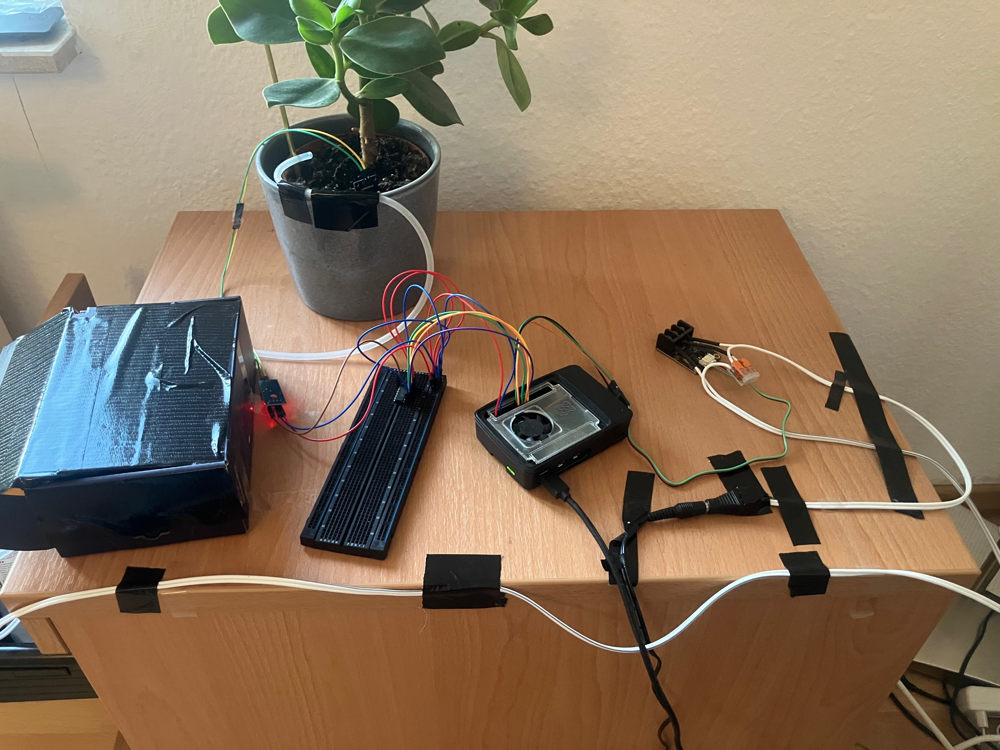
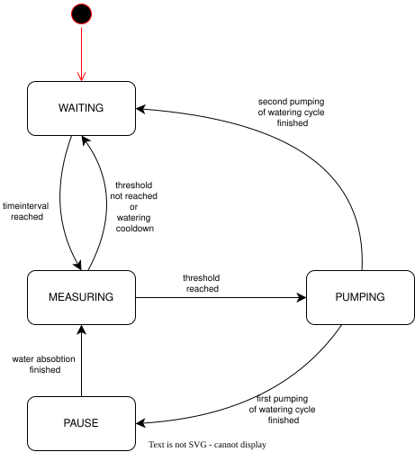

# Project: PLANT-WATERING

## 1. Project Overview



This plant-watering-system is designed to automate the watering of a plant. It uses a Raspberry Pi 5 as the controlling unit.
A 12 V DC Perestaltic Pump is used to transport the water through a tube to the plant. The system uses a humidity sensor to observe when watering is required.

The raspberry pi controls the 12 V pump via a GPIO pin that drives a MOSFET. For the sensor data the Pi is in contact with a ADC-Converter (MCP3008) 
that converts the analog sensor data into a digital one. The communication between the Converter and the Pi happens via SPI.
The code is written in python. The Logic is implemented via a state maschine that represents the current status like measuring or pumping.

## 2. Hardware Components

## Hardware Components

| Component | Description |
|---|---|
| Raspberry Pi 5 | Main controller running Raspberry Pi OS |
| MCP3008 | 10-bit ADC with SPI interface |
| Soil Moisture Sensor | Analog sensor with interface module |
| 12 V DC Peristaltic Pump | Pumps water to the plant |
| DFRobot MOSFET Module | Controls the pump via a GPIO signal |
| 12 V Power Supply | External power supply for the pump |
| Flyback Diode | Protects against voltage spikes from the pump motor |
| Breadboard & Jumper Wires | Electrical connections between components |

## 3. Hardware Setup / Wiring


The MCP3008 is placed on a breadboard and connected to the Raspberry Pi via SPI. The soil moisture sensor is placed in the soil and connected to the ADC. The pump transports water from a water container to the plant through a tube.

The pump uses a separate 12 V power supply and is switched by the MOSFET module.

### Wiring

| Connection | Interface |
|---|---|
| Raspberry Pi → MCP3008 | SPI0 (MOSI, MISO, SCLK, CE0) |
| Soil Moisture Sensor → MCP3008 | Analog output (AO) → CH0 |
| Raspberry Pi → MOSFET Module | GPIO 24 (BCM) |
| MOSFET Module → Pump | 12 V DC supply |
| Ground | Common ground between the circuits |
| Flyback Diode | Connected across the pump motor terminals |

## 4. Software Architecture

The software is written in Python and uses a state machine to control the watering process. The main loop executes different actions depending on the current state (`WAITING`, `MEASURING`, `PUMPING`, `PAUSE`, `ERROR`).

The `measure()` function reads five sensor values via SPI and calculates their average. Based on the measurement and active timers, `handle_measurement_result()` determines the next state.

The `ControllerData` class stores the current state, timestamps and pump counter. Relevant data is saved in a JSON file to preserve it across program restarts.

The following UML diagram shows the states and their transitions:




## 5. Watering Logic & Calibration

The system starts watering when the soil moisture sensor exceeds the upper threshold. After the first pump cycle, the system waits 90 minutes before measuring again. If the soil is still too dry, a second pump cycle is started.

A maximum of two pump cycles is allowed before a 24-hour cooldown period.

The pump was measured to deliver approximately 14 ml of water per minute.

| Parameter | Value |
|---|---|
| Upper threshold | 950 (ADC) |
| Lower threshold | 600 (ADC) |
| Pump duration | 9 min |
| Water per pump cycle | ~126 ml |
| Maximum water amount | ~252 ml |
| Absorption period | 90 min |
| Cooldown period | 24 h |

The threshold values are based on initial measurements and may need further calibration.

## 6. Installation & Setup

The project runs on a Raspberry Pi 5 with Raspberry Pi OS and Python 3.11 or newer.

First, enable SPI using `sudo raspi-config` under `Interface Options → SPI`.

Install the required tools:

```bash
sudo apt update
sudo apt install git python3-venv
```

Clone the repository:

```bash
git clone https://github.com/NilsL1234/plant-watering.git
cd plant-watering
```

Create a virtual environment and install the Python dependencies:

```bash
python3 -m venv .venv
.venv/bin/python -m pip install -e .
```

Start the program from the project directory:

```bash
.venv/bin/python src/main.py
```

The soil moisture thresholds may need adjustment depending on the sensor and soil conditions.

## 7. Automatic Startup (systemd)

The program can be configured as a systemd service to start automatically when the Raspberry Pi boots.

Create the service file:

```bash
sudo nano /etc/systemd/system/plant-watering.service
```

Add the following configuration. Replace `<username>` and adjust the project path if necessary.

```ini
[Unit]
Description=Plant Watering Controller

[Service]
Type=simple
User=<username>
WorkingDirectory=/home/<username>/plant-watering
ExecStart=/home/<username>/plant-watering/.venv/bin/python src/main.py
Restart=no

[Install]
WantedBy=multi-user.target
```

Reload systemd and enable automatic startup:

```bash
sudo systemctl daemon-reload
sudo systemctl enable --now plant-watering.service
```

Useful commands:

```bash
sudo systemctl start plant-watering.service
sudo systemctl stop plant-watering.service
sudo systemctl restart plant-watering.service
systemctl status plant-watering.service
journalctl -u plant-watering.service -f
```

The service uses the project's virtual environment and working directory. Logs can be viewed using `journalctl`.

## 8. Error Handling & Safety

The software checks the sensor values for invalid measurements. Five measurements are taken and their average is calculated. Values of 0 or 1023 and large differences between measurements are treated as errors.

After three consecutive measurement errors, the program enters the `ERROR` state and stops.

The pump is limited to two cycles and is switched off when the program exits normally or through a handled interruption.

The pump counter and timestamps are stored in a JSON file to preserve the watering state after program restarts. The current file-writing method is not fully protected against sudden power loss.

## 9. Testing

The hardware components were tested individually, including SPI communication, soil moisture measurement and pump control.

The state machine was tested using simulated sensor values and shorter time intervals.

The tests included:
- State transitions and pump cycles
- Absorption and cooldown timers
- Restarting the program during active timers
- Sensor measurement errors
- Maximum pump cycle limitation

## 10. Project Structure

```text
plant-watering/
├── src/
│   └── main.py
├── data/
│   └── .gitkeep
├── docs/
│   └── images/
└── README.md
```

- `src/`: Python source code
- `data/`: Controller data
- `docs/images/`: Hardware photos and diagrams
- `README.md`: Project documentation